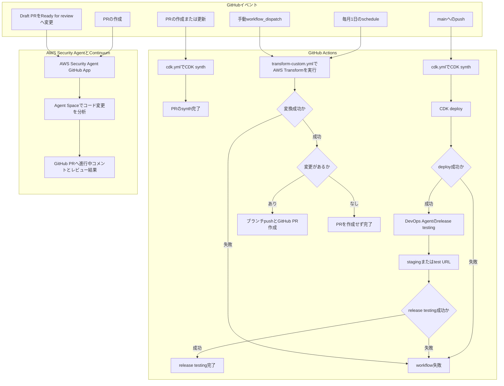
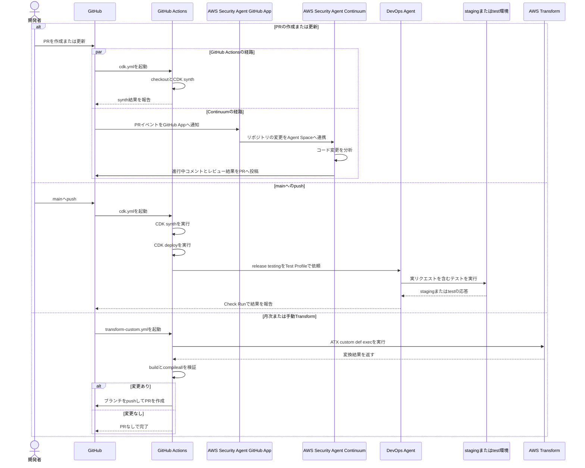

# AWSエージェント比較用の検証コード

Issue #2の記事で使う、AWS CDKとGitHub Actionsのサンプルです。

## 構成

| サンプル | 実装 | 確認方法 |
| --- | --- | --- |
| Lambda API | Python 3.12 + API Gateway HTTP API | `curl`でAPIのレスポンスを確認 |
| Reactデモ | React + Amazon ECS on Fargate | ECSタスクの公開IPへHTTPアクセス |
| DevOps Agent | 公式GitHub Actionによるリリーステスト | CDKデプロイ後にmain pushでstagingまたはtestを検証 |
| Well-Architected Agent | AWS CLIスクリプト | 数ヶ月に一度の手動アーキテクチャレビュー |
| AWS Transform custom | 公式ATX CLIによる月次modernization | 変更がある場合にGitHub PRを作成 |
| AWS Security Agent | GitHub AppによるPRコードレビュー | PR作成・更新時にセキュリティレビューを投稿 |

AWSエージェントのプレビュー機能や有料機能は、アカウントの契約・権限・リージョンによって
利用できない場合があります。
このリポジトリのCDKデプロイ、アプリの疎通確認、各サービスの呼び出しサンプルは分けて扱います。

## デプロイ

AWS CLIの認証とリージョン設定が済んでいることを前提にします。

```bash
cd cdk
npm ci
npm run build
npx cdk synth
npx cdk deploy --all --require-approval never
```

ECSサンプルは専用のVPCを作成し、パブリックサブネットにFargateタスクを配置します。
アカウントでVPC Block Public Accessが有効なため、CDKで対象VPCの除外を作成します。
この除外はECSタスクの公開IPへ到達するために必要です。

ECSサービスは公開IP付きのFargateタスクを1つ起動します。
検証後は、不要な課金を避けるために次のコマンドで削除してください。

```bash
npx cdk destroy --all
```

## スモークテスト

Lambda APIのURLはCDKのOutput `SampleApiStack.LambdaApiUrl`から取得します。

```bash
curl --fail "$LAMBDA_API_URL"
```

ECSタスクの公開IPは、次のように取得できます。

```bash
TASK_ARN=$(aws ecs list-tasks \
  --cluster aws-agents-comparison-sample-cluster \
  --service-name ReactEcsStack-Service \
  --query 'taskArns[0]' --output text)

ENI_ID=$(aws ecs describe-tasks \
  --cluster aws-agents-comparison-sample-cluster \
  --tasks "$TASK_ARN" \
  --query 'tasks[0].attachments[0].details[?name==`networkInterfaceId`].value' \
  --output text)

PUBLIC_IP=$(aws ec2 describe-network-interfaces \
  --network-interface-ids "$ENI_ID" \
  --query 'NetworkInterfaces[0].Association.PublicIp' \
  --output text)

curl --fail "http://${PUBLIC_IP}:3000/"
```

## Well-Architected Agent

ここでいうエージェントプロファイルは、レビュー対象のAWSアカウントそのものではありません。
レビュー対象のアカウントやリージョン、対象の柱、利用するIAMロールなどをまとめたレビュー設定です。

プロファイルの集約設定に、1つまたは複数のレビュー対象アカウントを指定します。
1アカウントだけをレビューする場合も、エージェントプロファイルは必要です。

AWS WA AgentのAPIはIAMロールを自動作成しません。
プロファイル側の実行ロールと、分析対象アカウント側のアクセスロールを事前に用意します。

`scripts/setup-wa-agent-roles.sh` は、ロールの作成とポリシー設定をCLIで行う補助スクリプトです。
デフォルトはプレビューだけで、作成する場合だけ `APPLY=true` を指定します。

```bash
export AWS_ACCOUNT_ID=202633084296
export APPLY=true
./scripts/setup-wa-agent-roles.sh
```

実行ロールには `wellarchitected.amazonaws.com` の信頼ポリシーと、アクセスロールを引き受ける
`sts:AssumeRole` が必要です。
アクセスロールには、実行ロールを信頼するポリシーと、AWS管理ポリシー
`WellArchitectedAgentResourceScanning` を設定します。

公式ドキュメント:

- [Getting started with AWS Well-Architected Agent][wa-getting-started]
- [AWS Well-Architected Agent access model][wa-access-model]
- [AWS managed policy: WellArchitectedAgentResourceScanning][wa-managed-policy]
- [API quickstart][wa-api-quickstart]
- [Conducting architecture reviews][wa-architecture-reviews]
- [API actions][wa-api-actions]
- [UpdateAgentRecommendationStatus][wa-update-status]

プロファイル作成後は、次のスクリプトを使います。

```bash
export PROFILE_ARN='arn:aws:wellarchitected:<region>:<account-id>:agent-profile/<name>'
export S3_URI='s3://<bucket>/<cdk-template>.zip'
./scripts/run-wa-review.sh
```

レビュー結果は`list-agent-recommendations`で確認します。
対応済みの指摘は、レコメンデーションARNを指定して次のようにクローズします。

```bash
aws wellarchitected update-agent-recommendation-status \
  --recommendation-arn "$RECOMMENDATION_ARN" \
  --status COMPLETED \
  --update-reason '対応済み'
```

## CI/CDの位置づけ

このリポジトリのGitHub Actions workflowは次の2本です。

| workflow | 起動条件と処理 |
| --- | --- |
| `cdk.yml` | PRでsynth、mainへのpushでsynth・CDK deploy・deploy後のrelease test |
| `transform-custom.yml` | 毎月1日または手動でATXを実行し、変更があればPRを作成 |

### AWS DevOps Agentの事前準備とrelease testing

GitHub Actionsからrelease testingを起動する前に、AWS DevOps Agent側でAgent Space、Test profile、
Webhookを準備します。
`cdk.yml`では、CDK deploy成功後に`aws-actions/devops-agent-qa@v1`を実行し、Webhook URL、
Webhook Secret、Test profile ID、任意のtest requirementをActionへ渡します。

#### Test profileの作成

1. AWS DevOps Agentで対象のAgent Spaceを用意します。
2. Agent SpaceのRelease Managerを開き、Test profileを作成します。
3. Test profileにstagingまたはtest環境のTarget URLを設定します。
4. 対象がWebアプリならUI testing、REST APIならAPI testingを選択します。
5. VPC内の非公開アプリを対象にする場合は、Release Management environmentとprivate connectionを
   別途設定し、Test profileからその環境を選択します。

release testingは探索的テスト中にPOST、PUT、DELETEなどの実リクエストを実行し得ます。
データの作成、変更、削除や通知などが起こる可能性があるため、本番URLは使わず、stagingまたはtest環境を
対象にしてください。Target URL、テスト種別、認証情報などはDevOps Agent側のTest profileで管理します。

#### Webhookの作成

1. DevOps Agentコンソールで対象のAgent Spaceを開きます。
2. **Capabilities**タブの**Webhook**セクションで**Configure**または**Add webhook**を選択します。
3. **Generic webhook**を作成し、GitHub Actionsから使う認証方式として**HMAC**を選択します。
4. 生成されたWebhook URLと署名Secretを保存します。Secretは作成時に一度だけ表示され、後から取得
   できないため、安全に保管してください。

HMACでは、送信側がtimestampとpayloadを署名し、AWS DevOps Agentが署名を検証します。
このリポジトリのworkflowでは公式Actionが署名を処理するため、独自の署名コードは追加しません。

#### GitHub Actions側の設定

GitHubリポジトリの
`Settings → Secrets and variables → Actions → Repository secrets`に、次の2つを登録します。

- `DEVOPS_AGENT_WEBHOOK_URL`
- `DEVOPS_AGENT_WEBHOOK_SECRET`

`Repository variables`には`DEVOPS_AGENT_TEST_PROFILE_ID`を登録します。Test profile IDは通常`ki-`で
始まります。`AWS_ROLE_ARN`は既存のRepository secretとして、CDK deployとAWS Transform customの実行に
使うGitHub Actions用IAMロールARNを登録します。

#### 動作確認

1. Test profileの対象となるstagingまたはtest環境が、先にデプロイ済みであることを確認します。
2. `main`へpushして`cdk.yml`を実行します。
3. CDK deploy成功後にrelease testingが起動し、GitHub Check Runが`in_progress`からpassまたはfailに
   変わることを確認します。
4. DevOps AgentのRelease Managerでも実行結果、テストケース、失敗内容を確認します。

WebhookまたはSecretが未設定の場合、release testingのActions stepは失敗します。

### AWS Security AgentとContinuum

AWS Security Agentは、現行ドキュメントではAWS Continuumの一部として扱われています。
SASTに近い静的なコードセキュリティ検査や、組織のセキュリティ要件の検証ができます。

Continuumのコードレビューは、GitHub Actionsのjobや `uses:` ではありません。
AWS Security AgentコンソールとGitHub App、Agent Spaceの設定によって、PRイベントを契機に
AWS側でコード変更を分析し、GitHub PRへレビュー結果を返す外部連携です。

公式手順は次のとおりです。

1. AWS Security AgentコンソールでGitHub integrationを追加します。
2. AWS Security Agent GitHub AppをGitHub OrganizationまたはUserへインストールします。
3. レビュー対象のリポジトリをAWS Security Agentへ接続します。
4. Agent SpaceでCode reviewを有効化します。
5. 対象リポジトリのCode review commentsを有効化します。
6. PRを作成するか、Draft PRをReady for reviewへ変更します。
7. PRに進行中コメントとレビュー結果が投稿されることを確認します。

この連携はmainへのpushで実行するGitHub Actions jobとは別経路です。
GitHub App、Agent Space、接続リポジトリ、レビュー設定はAWS側とGitHub側で事前に構成します。
詳細は[GitHub integrationの設定手順][security-agent-github]と
[GitHub PRのコードレビュー][security-agent-review]を参照してください。

### AWS Transform custom

月次workflowではAWS Transform customの公式ATX CLIをrunner上で実行します。
変換定義名、変換定義のバージョン、対象バージョンなどの追加コンテキストは、手動起動の入力または
Repository Variablesから指定します。変換定義名をworkflowに根拠なく固定していません。

次のRepository Variablesを使えます。手動起動の入力値がある場合は入力値を優先します。

| Variable | 用途 |
| --- | --- |
| `ATX_TRANSFORMATION_NAME` | 必須のAWS Transform transformation name |
| `ATX_TRANSFORMATION_VERSION` | 任意のtransformation version |
| `ATX_ADDITIONAL_PLAN_CONTEXT` | 目標バージョンや追加の変換条件 |
| `ATX_BUILD_COMMAND` | 変換後の検証に使うbuild command |

デフォルトの検証では `cdk` のNode.jsビルドとLambdaコードのPythonコンパイルを実行します。
変換による変更がある場合だけ、workflowがブランチをpushして `gh pr create` でPRを作成します。
変更がない場合はPRを作成しません。

AWS Transform continuous modernizationには、AWS側の管理インフラでdaily、weekly、monthlyの分析を
スケジュールし、PR remediationを行う方式もあります。
今回はGitHub Actionsを2本にする要件に合わせ、GitHub Actions runnerでATX CLIとghを実行する方式を
採用しています。どちらの方式でも、AWS Transformの利用条件、AWS認証、
`transform-custom:*`権限、利用可能な変換定義の準備が必要です。

### GitHub ActionsのSecretsとVariables

GitHubリポジトリの `Settings → Secrets and variables → Actions` から設定します。
`AWS_ROLE_ARN`はCDK deployとAWS Transform customの実行に使うGitHub Actions用IAMロールARNをRepository
secretに登録します。その他のSecretはWebhook URLやWebhook署名用Secretなど、ログに表示したくない値に
使います。Variableは、ログに表示されても問題ないTest profile ID、変換定義名やビルドコマンドなどの
設定値に使います。

| 名前 | 種類 | 用途 | 設定例 |
| --- | --- | --- | --- |
| `AWS_ROLE_ARN` | Repository Secret | GitHub OIDCで引き受けるAWS IAMロール | `arn:aws:iam::<AWS_ACCOUNT_ID>:role/<GITHUB_ACTIONS_ROLE_NAME>` |
| `DEVOPS_AGENT_WEBHOOK_URL` | Repository Secret | DevOps Agent Agent SpaceのWebhook URL | `https://<DEVOPS_AGENT_WEBHOOK_HOST>/<WEBHOOK_PATH>` |
| `DEVOPS_AGENT_WEBHOOK_SECRET` | Repository Secret | Webhook署名用Secret | `<WEBHOOK_SIGNING_SECRET>` |
| `DEVOPS_AGENT_TEST_PROFILE_ID` | Repository Variable | stagingまたはtest用のDevOps Agent Test Profile ID | `ki-<TEST_PROFILE_ID>` |
| `ATX_TRANSFORMATION_NAME` | Repository Variable | 月次Transformの変換定義名 | `AWS/<TRANSFORMATION_NAME>` |
| `ATX_TRANSFORMATION_VERSION` | Repository Variable | 任意の変換定義バージョン | `<TRANSFORMATION_VERSION>` |
| `ATX_ADDITIONAL_PLAN_CONTEXT` | Repository Variable | 任意の目標バージョンなどの追加条件 | `Upgrade Python 3.12 to 3.13` |
| `ATX_BUILD_COMMAND` | Repository Variable | 任意の変換後検証コマンド | `cd cdk && npm ci && npm run build && cd .. && python -m compileall apps/lambda-api` |

workflowでは、Secretを `${{ secrets.NAME }}`、Variableを `${{ vars.NAME }}` の形式で参照します。
たとえば、`AWS_ROLE_ARN` は `${{ secrets.AWS_ROLE_ARN }}`、
`ATX_BUILD_COMMAND` は `${{ vars.ATX_BUILD_COMMAND }}` として指定します。

`ATX_TRANSFORMATION_NAME` は対象に合わせたAWS Transformの変換定義名に変更してください。
`ATX_TRANSFORMATION_VERSION`、`ATX_ADDITIONAL_PLAN_CONTEXT`、`ATX_BUILD_COMMAND` なども、
このリポジトリの対象と目標バージョン、検証方法に合わせて変更します。
上記の例には実際のAWS ARN、Webhook URL、Webhook secret、Test Profile IDを記載していません。

## GitHub Actions ワークフロー

次のフローチャートは、`cdk.yml`、`transform-custom.yml`、ContinuumのPR連携を分離して示します。



次のシーケンス図は、PRのsynth、ContinuumのPRレビュー、main push後のrelease testing、
月次または手動のTransformという4経路を示します。



## 公式ドキュメント

- [AWS Security AgentのGitHub integration設定][security-agent-github]
- [AWS Security AgentのGitHub PRコードレビュー][security-agent-review]
- [AWS Security Agentコードレビューの有効化][security-agent-enable]
- [AWS Transform continuous modernization][transform-continuous]
- [AWS Transform custom][transform-custom]
- [AWS Transform customのユースケース][transform-use-cases]
- [AWS Transform CLI command reference][transform-command-reference]
- [AWS DevOps Agent webhook設定][devops-webhook]
- [AWS DevOps Agent release testing][devops-release-testing]
- [AWS DevOps Agent release readiness code reviews][devops-release-readiness]
- [AWS DevOps Agent GitHub Action][devops-agent-action]

[wa-getting-started]: https://docs.aws.amazon.com/wellarchitected/latest/userguide/agent-getting-started.html
[wa-access-model]: https://docs.aws.amazon.com/wellarchitected/latest/userguide/security-iam-agent.html
[wa-managed-policy]: https://docs.aws.amazon.com/aws-managed-policy/latest/reference/WellArchitectedAgentResourceScanning.html
[wa-api-quickstart]: https://docs.aws.amazon.com/wellarchitected/latest/userguide/agent-api-quickstart.html
[wa-architecture-reviews]: https://docs.aws.amazon.com/wellarchitected/latest/userguide/agent-architecture-reviews.html
[wa-api-actions]: https://docs.aws.amazon.com/wellarchitected/latest/userguide/wa-api-actions.html
[wa-update-status]: https://docs.aws.amazon.com/wellarchitected/latest/APIReference/API_UpdateAgentRecommendationStatus.html
[security-agent-github]: https://docs.aws.amazon.com/securityagent/latest/userguide/connect-github.html
[security-agent-review]: https://docs.aws.amazon.com/securityagent/latest/userguide/review-code-findings-github.html
[security-agent-enable]: https://docs.aws.amazon.com/securityagent/latest/userguide/enable-code-review-scan.html
[transform-continuous]: https://docs.aws.amazon.com/transform/latest/userguide/continuous-modernization.html
[transform-custom]: https://docs.aws.amazon.com/transform/latest/userguide/custom.html
[transform-use-cases]: https://docs.aws.amazon.com/transform/latest/userguide/custom-common-use-cases.html
[transform-command-reference]: https://docs.aws.amazon.com/transform/latest/userguide/custom-command-reference.html
[devops-webhook]: https://docs.aws.amazon.com/devopsagent/latest/userguide/configuring-integrations-and-knowledge-invoking-devops-agent-through-webhook.html
[devops-release-testing]: https://docs.aws.amazon.com/devopsagent/latest/userguide/release-management-release-testing.html
[devops-release-readiness]: https://docs.aws.amazon.com/devopsagent/latest/userguide/release-management-release-readiness-code-review.html
[devops-agent-action]: https://github.com/aws-actions/devops-agent-qa
